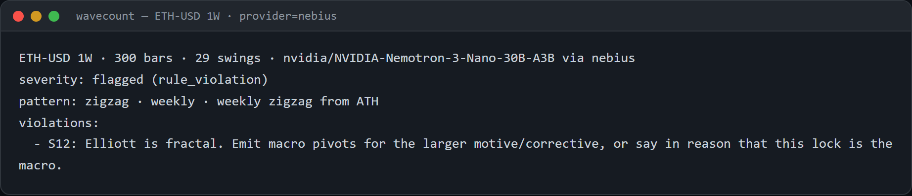
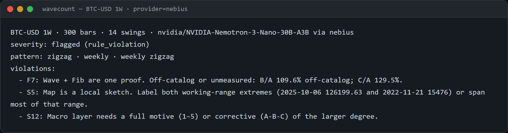
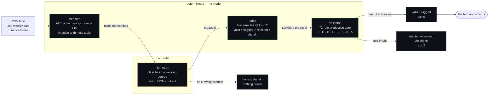
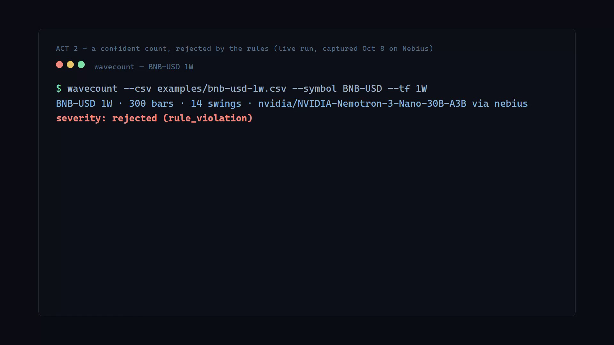
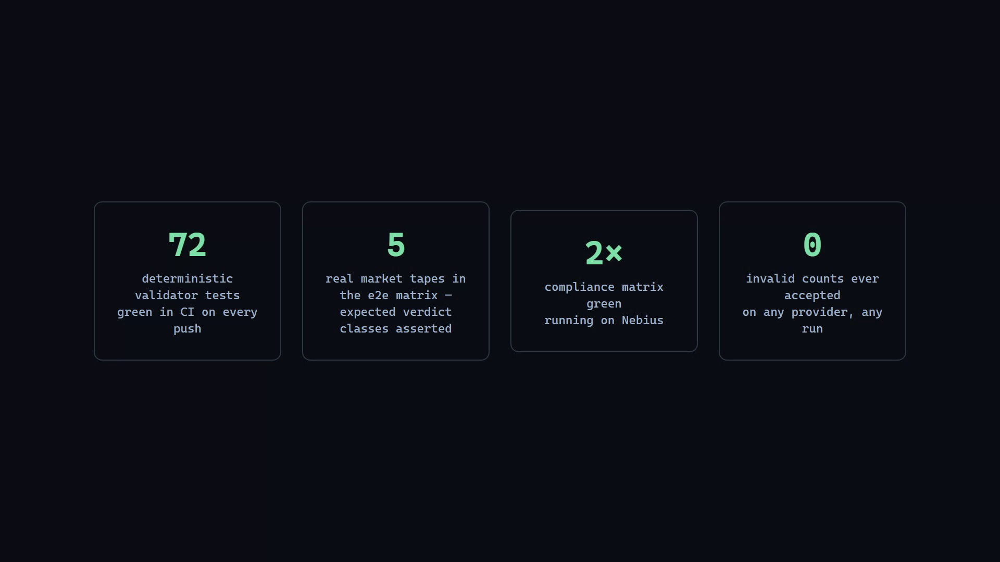

# tradecharts-nemotron

> Nemotron proposes the wave count. A deterministic validator gates it. The human confirms.
> **Rules over vibes.** An interpretive map — not a signal, not advice.

<p align="center"></p>

The open engine surface of [TradeCharts](https://tradecharts.app): a standalone CLI that measures a tape deterministically, asks a Nemotron model to classify the working degree, and gates the proposed Elliott Wave count against deterministic rules before any verdict is issued. No shared git history with the commercial desk; the desk only reads.

Built for the **Nebius x NVIDIA Global AI Hackathon** (registration 3180710, due Oct 30 2026, track: Best Apps and Agents). Demo video: the engine driving the live desk end-to-end.

## Providers — read this first

Two companies, same models, different jobs. **Only Nebius counts for the hackathon submission.**

| Provider | Endpoint | Use |
|---|---|---|
| `nebius` | `api.studio.nebius.com/v1` — verified live 2026-10-08 | ✅ **The submitted demo runs on this** — rules require Nebius. `nvidia/NVIDIA-Nemotron-3-Nano-30B-A3B`, 11–42 s per count, compliance matrix green twice |
| `nvidia` | `integrate.api.nvidia.com` | ❌ Not the submission path. Development, tests, and the desk's BYOK provider feature |

Nebius serves no omni — their text nano is the compliant default (needs the full 16k token budget: reasoning runs in its own channel before content). Same OpenAI-compatible dialect behind one interface (`src/provider/`) — switching is two env vars (`WAVECOUNT_PROVIDER=nebius NEBIUS_API_KEY=...`), zero code changes. The engine never knows which one is behind it.

### Model notes (probed live, 2026-10-06)

| Model on our key | Behavior |
|---|---|
| `nemotron-3-nano-omni-30b-a3b-reasoning` | ✅ **default** — reasons in-channel, returns the JSON, ~50–110 s per count |
| `nemotron-3.5-lightning-30b-a3b` | ⚠️ thinks out loud past any token cap (no JSON lands) |
| `nemotron-3-super-120b-a12b` | ⚠️ returns empty content on this task |

## Run

```bash
npm install
cp .env.example .env   # fill keys from your secrets store

# NVIDIA provider (dev) — default tape is examples/eth-usd-1w.csv
NVIDIA_API_KEY=nvapi-... npm run wavecount -- --symbol ETH-USD --tf 1W

# Nebius provider (hackathon path)
WAVECOUNT_PROVIDER=nebius NEBIUS_API_KEY=... npm run wavecount -- --symbol ETH-USD --tf 1W

# Full matrix over every example tape (asserts per-tape expected classes)
NVIDIA_API_KEY=nvapi-... npm run e2e
```

Output: a verdict. Three real behaviors, all observed live:

```
$ wavecount --csv examples/eth-usd-1w.csv --symbol ETH-USD --tf 1W
ETH-USD 1W · 300 bars · 29 swings · nvidia/nemotron-3-nano-omni-30b-a3b-reasoning via nvidia
honest abstain — no 5-swing impulse window (nothing drawn, no retry)

$ wavecount --csv examples/btc-usd-1w.csv --symbol BTC-USD --tf 1W
BTC-USD 1W · 300 bars · 14 swings · nvidia/nemotron-3-nano-omni-30b-a3b-reasoning via nvidia
severity: rejected (rule_violation)
pattern: impulse · weekly · weekly impulse from 2022-11-21 low
violations:
  - H1: Wave 3 cannot be the shortest of 1/3/5.
  - H2: Wave 4 overlaps wave 1 in a cash impulse.
  - S7: Waves 2 and 4 do not alternate (both deep or both shallow).
```

The model proposes; the deterministic gate rejects or flags; nothing invalid passes; a human confirms. Exit codes: 0 valid/flagged/abstain · 2 rejected.

The same runs captured live on the **Nebius submission path** (recorded 2026-10-08, `WAVECOUNT_PROVIDER=nebius`):

<p align="center"></p>

<p align="center"></p>

Every advisory is named by rule id (`F7`, `S5`, `S12`…) — the verdict is an audit trail, not a vibe.

## How it works



**Tools measure, the model classifies, the validator gates, the human confirms.** The model never sees a chart and never re-derives wave arithmetic — the impulse table is precomputed, so classification is reading, not guessing. Green boxes are pure functions; the one amber box is the only place a model is trusted, and it is never trusted alone: two samples are judged deterministically, and every verdict passes the rule gate before it exists.

In [TradeCharts](https://tradecharts.app) (the closed desk) the same engine powers the **Propose** action — the desk only reads:

<p align="center"></p>

## Testing

<p align="center"></p>

| Layer | What | Status |
|---|---|---|
| Unit | validator rules — 72 tests, unmodified production copy | ✅ `npm test` |
| Compliance E2E | the same matrix on `WAVECOUNT_PROVIDER=nebius` (allow-lists in `e2e-expected.nebius.json`) | ✅ green twice, 2026-10-08 |
| E2E matrix | every example tape through the live pipeline; per-tape expected classes in `e2e-expected.json` (allow-lists absorb model nondeterminism; the asserted invariant is that **no invalid count is ever accepted**) | `npm run e2e` |
| CI | tsc + vitest on every push | `.github/workflows/ci.yml` |

## Layout

```
src/provider/    index.ts (interface + OpenAI-compatible client) · nvidia.ts · nebius.ts
src/engine/      measure.ts (deterministic facts) · prompt.ts (classification contract) · pipeline.ts (gate wiring)
src/validator/   the production gate (copied, tested — 72 tests) · types.ts · judge.ts
scripts/e2e.mjs  the tape matrix runner
examples/        real weekly tapes (ETH, BTC, BNB, SOL, DOGE — Binance klines)
```

## Honesty

- TradeCharts (tradecharts.app) is a live commercial product; this repo is the open engine surface, not the desk.
- The validator is deterministic; the model proposes, rules gate, the human confirms. Confirmed counts are private desk data.
- The Nemotron models used here are NVIDIA open models; the hackathon submission path runs on Nebius.
- License: Apache-2.0.
