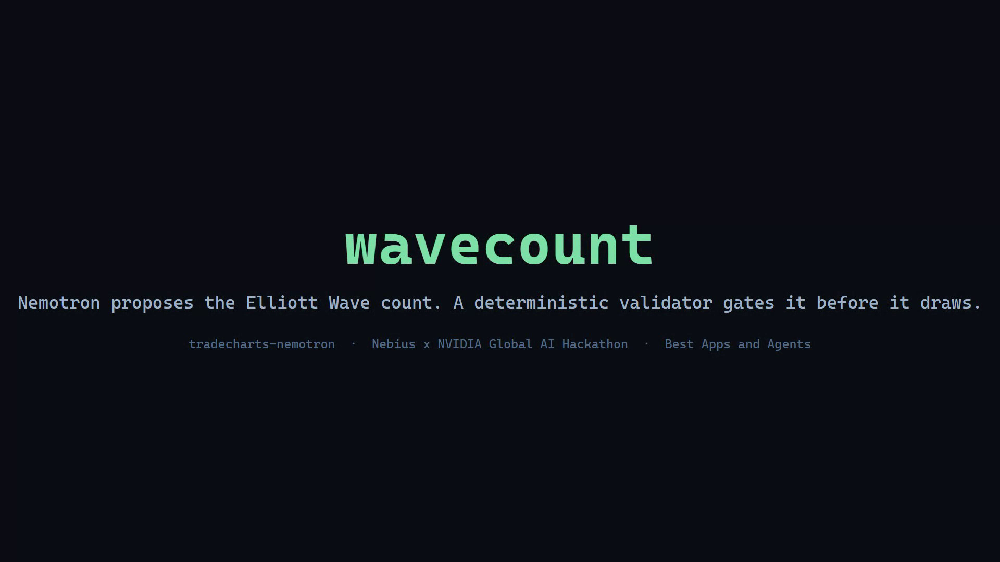
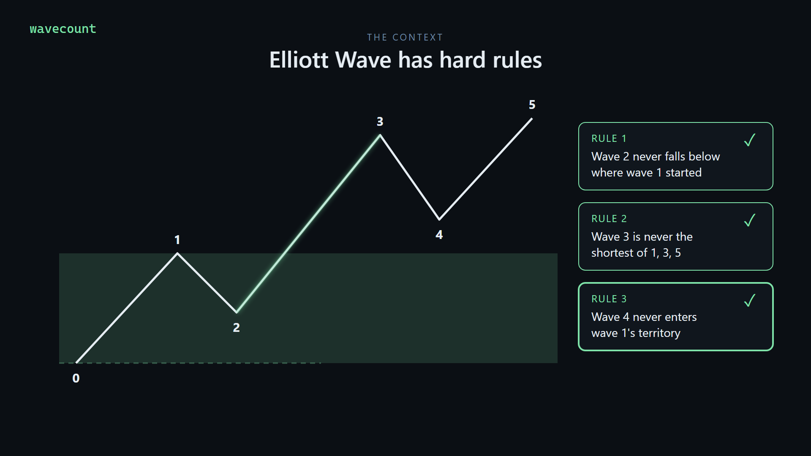
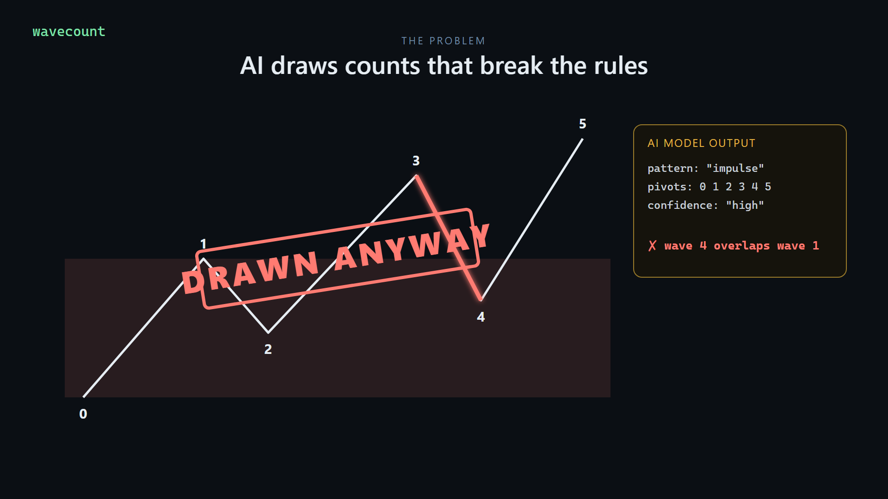
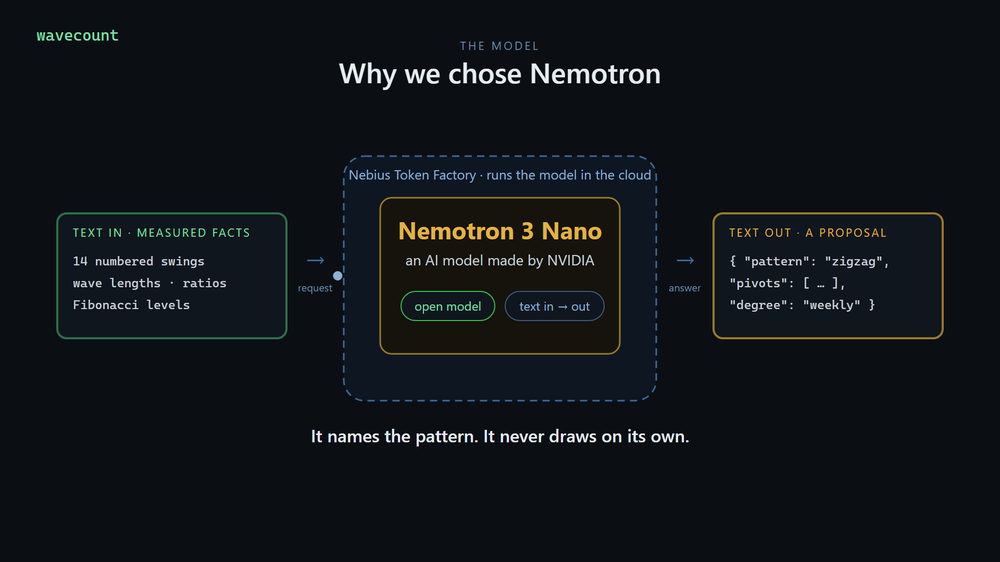
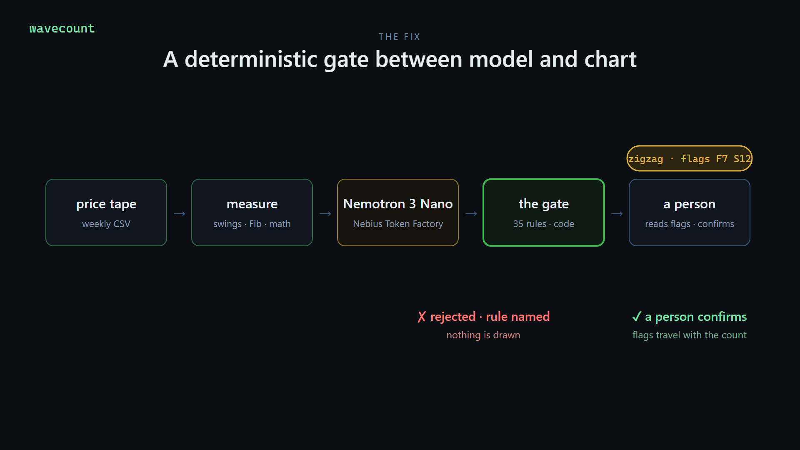
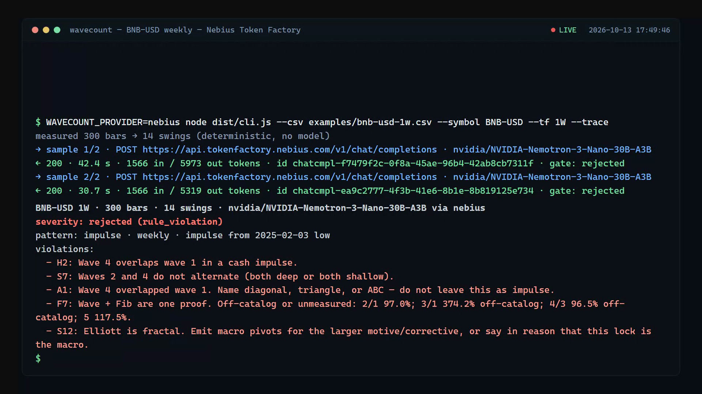
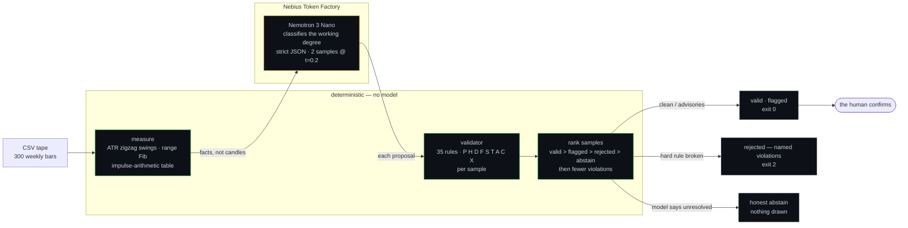
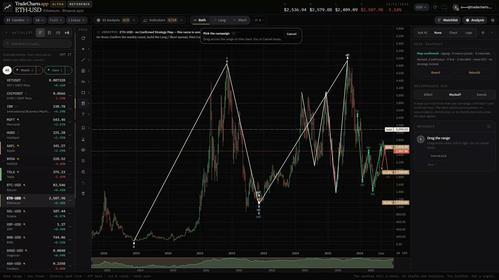
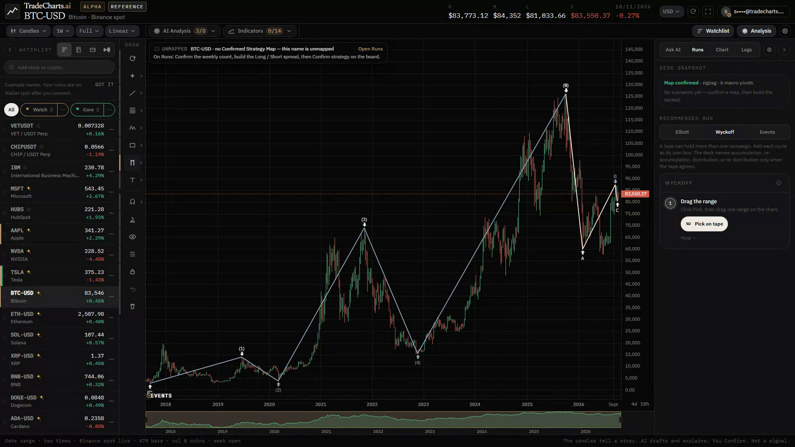
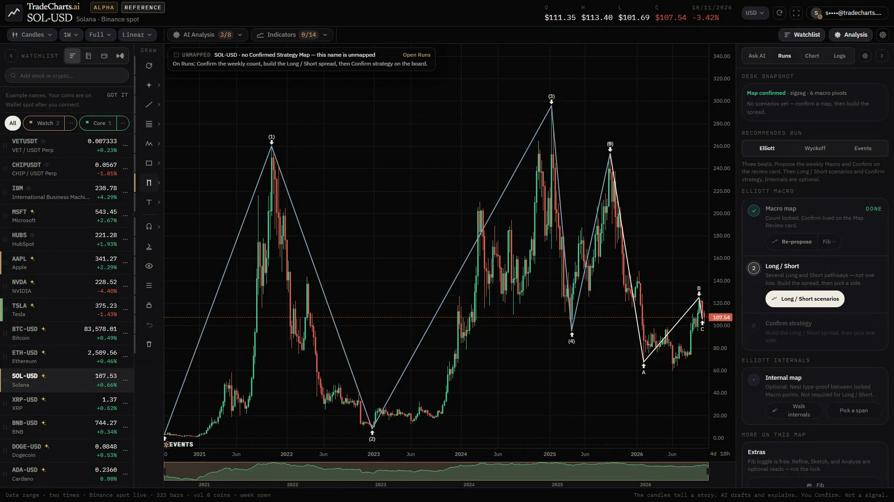

# tradecharts-nemotron

> NVIDIA Nemotron on Nebius Token Factory proposes the Elliott Wave count. A deterministic validator gates it. The human confirms.
> **Rules over vibes.** An interpretive map — not a signal, not advice.

<p align="center"></p>

`wavecount` is the open engine surface of [TradeCharts](https://tradecharts.app): a standalone CLI that measures a price tape deterministically, asks **Nemotron 3 Nano on Nebius Token Factory** to classify the working wave degree, and gates the proposed count against 35 deterministic Elliott rules before any verdict exists.

Built for the **Nebius x NVIDIA Global AI Hackathon** (track: Best Apps and Agents).

**Demo video (2:37):** [youtu.be/GKrzD-3MAbQ](https://youtu.be/GKrzD-3MAbQ). An animated intro explains the problem and why we chose Nemotron; every model call after it is a live request to Token Factory, followed by a look at the live desk; the raw transcripts with completion ids are in [`evidence/2026-10-13/`](evidence/2026-10-13/).

## The problem, in four pictures

Stills from the demo video.

<table>
<tr>
<td width="50%"><br><sub><b>1 · Elliott Wave has hard rules.</b> Wave 2 never falls below the start of wave 1, wave 3 is never the shortest, wave 4 never enters wave 1's territory.</sub></td>
<td width="50%"><br><sub><b>2 · The problem.</b> Ask an AI model to label a chart and it answers confidently, even when wave 4 drops into wave 1's zone. Most AI chart tools draw it anyway.</sub></td>
</tr>
<tr>
<td width="50%"><br><sub><b>3 · Why Nemotron.</b> An open NVIDIA model, small and fast enough to sample twice per count, served by Nebius Token Factory. It reads measured facts and names the pattern. It never draws on its own.</sub></td>
<td width="50%"><br><sub><b>4 · The gate.</b> A rule-breaking count is stopped with the rule named and nothing drawn. A sound count passes with its flags, and a person decides.</sub></td>
</tr>
</table>

## Runs on Nebius Token Factory

| | |
|---|---|
| Endpoint | `https://api.tokenfactory.nebius.com/v1` (OpenAI-compatible chat completions) |
| Model | `nvidia/NVIDIA-Nemotron-3-Nano-30B-A3B` — NVIDIA open model |
| Calls per count | 2 samples at temperature 0.2, ~20–55 s each, ~1.6k prompt tokens |
| Code | [`src/provider/nebius.ts`](src/provider/nebius.ts) on the shared client in [`src/provider/index.ts`](src/provider/index.ts) |

Token Factory is the default provider. The repo also keeps an `nvidia` provider (`integrate.api.nvidia.com`) for development; it is not the submission path. Same dialect, one interface — the engine never knows which is behind it.

## Run

```bash
npm install
cp .env.example .env    # set NEBIUS_API_KEY (from tokenfactory.nebius.com)

# One tape, with every model call traced (endpoint, latency, tokens, completion id)
NEBIUS_API_KEY=... npm run wavecount -- --csv examples/btc-usd-1w.csv --symbol BTC-USD --tf 1W --trace

# Every example tape, asserting the allowed verdict classes in e2e-expected.nebius.json
NEBIUS_API_KEY=... npm run e2e

# Deterministic validator tests — no key, no network
npm test
```

A live run on Token Factory (2026-10-13, verbatim from [`evidence/2026-10-13/btc.txt`](evidence/2026-10-13/btc.txt)):

```
$ WAVECOUNT_PROVIDER=nebius node dist/cli.js --csv examples/btc-usd-1w.csv --symbol BTC-USD --tf 1W --trace
measured 300 bars → 14 swings (deterministic, no model)
→ sample 1/2 · POST https://api.tokenfactory.nebius.com/v1/chat/completions · nvidia/NVIDIA-Nemotron-3-Nano-30B-A3B
← 200 · 49.3 s · 1622 in / 9235 out tokens · id chatcmpl-830d1800-ecee-4f4f-a68d-24289f7c69f6 · gate: flagged
→ sample 2/2 · POST https://api.tokenfactory.nebius.com/v1/chat/completions · nvidia/NVIDIA-Nemotron-3-Nano-30B-A3B
← 200 · 43.1 s · 1622 in / 6678 out tokens · id chatcmpl-b5364fa0-3da7-4c9f-84a3-32b26a8a792c · gate: flagged
BTC-USD 1W · 300 bars · 14 swings · nvidia/NVIDIA-Nemotron-3-Nano-30B-A3B via nebius
severity: flagged (rule_violation)
pattern: zigzag · weekly · weekly zigzag from ATH
violations:
  - F7: Wave + Fib are one proof. Off-catalog or unmeasured: B/A 109.6% off-catalog; C/A 129.5%.
  - S5: Map is a local sketch. Label both working-range extremes (2025-10-06 126199.63 and 2022-11-21 15476) or span most of that range.
  - S12: Macro layer needs a full motive (1–5) or corrective (A-B-C) of the larger degree.
```

The same session on BNB: Nemotron proposed a five-wave impulse and the gate **rejected** it — `H2: Wave 4 overlaps wave 1`, plus `S7`, `A1`, `F7`, `S12` ([`bnb.txt`](evidence/2026-10-13/bnb.txt)). Nothing is drawn for a rejected count. This is the run shown in the demo video:

<p align="center"></p> Exit codes: 0 valid / flagged / abstain · 2 rejected · 3 provider unavailable.

## How it works



**Tools measure, the model classifies, the validator gates, the human confirms.** The model never sees a chart and never re-derives wave arithmetic: the swings, Fibonacci levels, and a per-window impulse table are precomputed, so classification is reading, not guessing. The amber box is the only place a model is trusted, and never alone — every sample passes the 35-rule gate, and the samples are ranked deterministically.

## Testing

| Layer | What | Status |
|---|---|---|
| Unit | validator — 72 tests over the 35 rules, copied unmodified from the production desk | ✅ `npm test`, CI on every push |
| Live E2E (submission path) | every example tape through Token Factory; allowed classes per tape in `e2e-expected.nebius.json` | ✅ `npm run e2e` |
| Live E2E (dev) | same matrix on the NVIDIA provider (`e2e-expected.json`) | `WAVECOUNT_PROVIDER=nvidia npm run e2e` |
| CI | `tsc` + `vitest` on push and PR | `.github/workflows/ci.yml` |

The allow-lists absorb model nondeterminism (Nemotron may read a tape as an impulse one run and a zigzag the next), so the e2e asserts verdict classes, not exact text. The safety property comes from the pipeline itself: a hard-rule break makes the verdict `rejected`, and a rejected count is never output as a pass.

## Evidence

- [`evidence/2026-10-13/`](evidence/2026-10-13/) — live Token Factory runs on BNB, BTC, ETH, SOL plus the unit suite, recorded for the demo video: timestamps, endpoint, token counts, completion ids.
- [`evidence/2026-10-08/`](evidence/2026-10-08/) — the first compliance runs, made on Nebius's earlier `api.studio.nebius.com` hostname before the switch to the Token Factory URL ([ETH](docs/assets/verdict-eth-nebius.png) and [BTC](docs/assets/verdict-btc-nebius.png) screenshots).
- [Demo video](https://youtu.be/GKrzD-3MAbQ) — the BNB run in [`evidence/2026-10-13/bnb.txt`](evidence/2026-10-13/bnb.txt) is the one shown on screen, completion ids included. Long model waits are trimmed in the edit, and each cut is labelled on screen with the seconds removed.

## Layout

```
src/provider/    index.ts (interface + OpenAI-compatible client) · nebius.ts (Token Factory) · nvidia.ts (dev)
src/engine/      measure.ts (deterministic facts) · prompt.ts (classification contract) · pipeline.ts (samples, gate, rank)
src/validator/   the production gate (35 rules, 72 tests) · types.ts · judge.ts (optional advisory merge, unused by the CLI)
scripts/         e2e.mjs (tape matrix) · demo.sh (three-act terminal demo)
examples/        real weekly tapes (ETH, BTC, BNB, SOL, DOGE)
evidence/        recorded live runs
```

## The live desk: tradecharts.app

[TradeCharts](https://tradecharts.app) is a live commercial charting desk, and this gate lives inside it. Every map on these charts was proposed by a model, checked by the same validator this repo publishes, and confirmed by a person. The desk's own hosted model is configured separately and is not part of this submission. Screenshots from a signed-in session on tradecharts.app (2026-10-13):

<table>
<tr>
<td width="50%"><br><sub>ETH-USD weekly, confirmed map</sub></td>
<td width="50%"><br><sub>BTC-USD weekly, confirmed map</sub></td>
</tr>
</table>

<p align="center"><br><sub>SOL-USD weekly with the Elliott run panel: the macro map is locked only after a person confirms it</sub></p>

## Built during the hackathon

This repository was created during the submission period. The validator in `src/validator/` predates it — it was copied unmodified from the TradeCharts desk, with its tests. New for the hackathon: the Token Factory provider layer, the deterministic measure stage and impulse table, the classification prompt contract, the two-sample pipeline, the CLI with `--trace`, the e2e matrix, CI, and the demo tooling.

## Honesty

- This repo is the open engine surface, not the desk. Confirmed counts and the desk itself stay private.
- The validator is deterministic; the model proposes, rules gate, a human confirms. Output is an interpretive map — not a signal, not advice.
- Nemotron is an NVIDIA open model; the submission path runs it on Nebius Token Factory.
- License: Apache-2.0.
